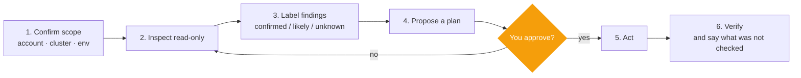

<p align="center">
  
</p>

<p align="center">
  <a href="https://github.com/rsmrtk/DevOps-Skills/actions/workflows/ci.yml"></a>
  
  
  
  
  
</p>

<h3 align="center">A careful DevOps/SRE operator for Claude Code</h3>

<p align="center">
  11 skills, 1 agent and 3 offline analyzers that make Claude <b>read the plan, check the blast radius and ask before it acts</b>.<br>
  Terraform · IAM · GitOps · GitHub Actions · SLOs · Kubernetes · Networking · FinOps · Postmortems · Patroni
</p>

<p align="center">
  <a href="#-install-in-3-steps">Install</a> ·
  <a href="#-which-skill-do-i-use">Which skill?</a> ·
  <a href="#-how-to-make-a-skill-run">How to trigger</a> ·
  <a href="#-whats-inside">What's inside</a> ·
  <a href="#-evidence-honestly">Evidence</a> ·
  <a href="#-faq">FAQ</a>
</p>

---

## ✨ In 30 seconds

Claude already *knows* DevOps. What it does not do reliably is **behave like a careful operator**. These skills add that behaviour.

| Situation | Typical Claude without the skills | With the skills |
|---|---|---|
| "Add the DB password to the app config" | Commits `password: hunter2` to Git and pushes to `main`, then warns afterwards *(measured)* | Keeps it out of Git, explains the limitation, points to SOPS / Sealed Secrets *(measured)* |
| "Is this Terraform plan safe?" | Skims the diff | Reads destroys and replacements from `plan.json`, returns **safe / safe with conditions / blocked** *(designed)* |
| "Why did the bill go up?" | Can compare a partial month with a full one | Detects the partial month, includes credit/tax/Savings Plan lines, ranks real drivers *(designed, analyzer)* |
| Any production change | Acts | Inspects read-only, writes a plan, **waits for your approval** *(designed)* |

<sub>*Measured* = observed in our tests. *Designed* = a rule written into the skill, not separately measured.</sub>

> **Honest expectations.** In our tests the skills did *not* make Claude smarter at one-shot questions. They changed *behaviour* where it matters. Think **guardrails**, not a knowledge upgrade. Full numbers are in [Evidence](#-evidence-honestly).

## 🚀 Install in 3 steps

```bash
# 1. add the marketplace
claude plugin marketplace add rsmrtk/DevOps-Skills

# 2. install the plugin
claude plugin install devops-sre@devops-skills

# 3. start a new session (or run /reload-plugins), then check
claude plugin list
```

<details>
<summary>Install from a local clone instead</summary>

```bash
git clone https://github.com/rsmrtk/DevOps-Skills && cd DevOps-Skills
claude plugin marketplace add .
claude plugin install devops-sre@devops-skills
```
</details>

> The marketplace is called **`devops-skills`**, the plugin inside it is **`devops-sre`**. That is why skills are invoked as `/devops-sre:<skill>`.

## 🧭 Which skill do I use?

| I want to… | Use | Example prompt |
|---|---|---|
| Check a Terraform/OpenTofu plan before `apply` | [`reviewing-terraform-changes`](plugins/devops-sre/skills/reviewing-terraform-changes) | "Here is the plan. Can I apply it to prod?" |
| Review IAM policies, roles, OIDC trust | [`reviewing-cloud-iam`](plugins/devops-sre/skills/reviewing-cloud-iam) | "Is this deploy role too permissive? It has `iam:PassRole` on `*`." |
| Secure GitHub Actions workflows | [`hardening-github-actions`](plugins/devops-sre/skills/hardening-github-actions) | "Audit `.github/workflows` for secrets and fork risks." |
| Debug or review Argo CD / Flux / Helm | [`operating-gitops`](plugins/devops-sre/skills/operating-gitops) | "My Argo CD app is stuck OutOfSync, why?" |
| Define SLOs and alerts | [`designing-slo-alerting`](plugins/devops-sre/skills/designing-slo-alerting) | "Set up burn-rate alerts for our API." |
| Triage a Kubernetes problem | [`troubleshooting-kubernetes`](plugins/devops-sre/skills/troubleshooting-kubernetes) | "Pod is CrashLoopBackOff, find out why." |
| Find a network fault | [`diagnosing-network-issues`](plugins/devops-sre/skills/diagnosing-network-issues) | "Service times out from the cluster. DNS? TLS?" |
| Operate HA PostgreSQL | [`operating-patroni-consul`](plugins/devops-sre/skills/operating-patroni-consul) | "How long does a Patroni failover take with this DCS?" |
| Write a postmortem or runbook | [`writing-postmortems-and-runbooks`](plugins/devops-sre/skills/writing-postmortems-and-runbooks) | "Draft a postmortem from these notes." |
| Cut cloud or cluster cost safely | [`auditing-cloud-costs`](plugins/devops-sre/skills/auditing-cloud-costs) | "How do we save on AWS without hurting production?" |
| Analyze a billing export file | [`analyzing-billing-exports`](plugins/devops-sre/skills/analyzing-billing-exports) | "Why did September cost more than August?" + attach the CUR/CSV |
| Not sure, or a mixed task | agent [`devops-sre-engineer`](plugins/devops-sre/agents/devops-sre-engineer.md) | "Use the devops-sre-engineer agent to look at this." |

## 🎯 How to make a skill run

Claude decides on its own whether to load a skill, and **for simple requests it often does not** (measured recall: roughly 12-50%). To be sure:

| Method | How | Reliability |
|---|---|---|
| **Slash command** | `/devops-sre:reviewing-terraform-changes`, then your request | ⭐⭐⭐ |
| **Name it** | "Use the `operating-gitops` skill to debug this app" | ⭐⭐⭐ |
| **Ask the agent** | "Use the `devops-sre-engineer` agent for this" (it routes to the right skill) | ⭐⭐⭐ |
| **Just describe the task** | "My Argo CD app is OutOfSync, why?" | ⭐⭐, better with a concrete, multi-step request and pasted output |

A `Skill` tool call in the transcript shows that a skill loaded. If you do not see one, invoke it explicitly.

## 🤖 The agent

**`devops-sre-engineer`** picks the right skill and works under fixed rules.



- 🔒 **Read-only by default.** Changes need your explicit approval.
- 🧾 **Honest labels.** Every conclusion is *confirmed*, *likely* or *unknown*, with what was **not** checked.
- 🔑 **No secrets in output.** Logs and files are treated as data, not instructions.

## 📦 What's inside


<sub>Blue skills ship an offline analyzer script.</sub>

| Area | Skills |
|---|---|
| 🏗️ **Infrastructure** | `reviewing-terraform-changes` · `reviewing-cloud-iam` |
| 🚀 **Delivery** | `hardening-github-actions` · `operating-gitops` |
| 📈 **Reliability** | `designing-slo-alerting` · `troubleshooting-kubernetes` · `diagnosing-network-issues` · `operating-patroni-consul` · `writing-postmortems-and-runbooks` |
| 💰 **FinOps** | `auditing-cloud-costs` · `analyzing-billing-exports` |

Triggers, rules and example prompts for every skill: **[docs/SKILLS.md](docs/SKILLS.md)**.

## 🛠️ Bundled analyzers

Three skills ship scripts you can also run by hand. They are **offline, read-only, never print secret values**, and need no network.

| Tool | Input | Finds |
|---|---|---|
| [`lint_iam_policy.py`](plugins/devops-sre/skills/reviewing-cloud-iam/scripts/lint_iam_policy.py) | AWS IAM policy JSON | `Action:*` on `*`, `NotAction`, escalation actions, `Principal:*`, loose OIDC `sub`, trust without conditions |
| [`gitops_lint.py`](plugins/devops-sre/skills/operating-gitops/scripts/gitops_lint.py) | Argo CD / Flux / Kustomize repo | plaintext Secrets, credentials in URLs, `:latest`, unpinned charts, default AppProject, `commonLabels`, `Replace`/`force` |
| [`analyze_billing.py`](plugins/devops-sre/skills/analyzing-billing-exports/scripts/analyze_billing.py) | AWS CUR, GCP or Azure export | partial months, line-type totals, month-over-month drivers, spikes vs step changes, idle lines, untagged spend |

Requires Python 3.8+. `gitops_lint.py` also needs PyYAML (`pip install pyyaml`); the other two use only the standard library.

<details>
<summary><b>Sample output: IAM linter</b></summary>

```text
$ python3 lint_iam_policy.py policies/
CRITICAL IAM001 ...Statement[0]/DevAll: Action * on Resource *: full administrator
CRITICAL IAM007 ...Statement[0]: OIDC federated trust without a `sub` condition: any identity from that provider can assume the role
CRITICAL IAM005 ...Statement[0]: Principal * without a Condition: anyone, including anonymous or any AWS account
HIGH     IAM003 ...Statement[0]/Deployer: iam:PassRole on a wildcard resource: privilege escalation
HIGH     IAM007 ...Statement[0]: OIDC sub condition 'repo:acme/*' is too broad: pin repo and ref/environment
MEDIUM   IAM006 ...Statement[0]: cross-account trust to ...:root without ExternalId or other Condition

20 finding(s) in 9 policy document(s). SCPs, permission boundaries, session policies and actual usage were not evaluated.
```
<sub>Abridged output on the test fixtures in <code>evals/fixtures/</code>.</sub>
</details>

<details>
<summary><b>Sample output: billing analyzer</b></summary>

```text
MONTHS
  2026-09: total    26,652.63  days 30/30
  2026-10: total    11,209.73  days 12/31  ** PARTIAL **
      per-day avg 934.14; linear projection for full month 28,958.34 (an estimate, not a forecast)

MONTH OVER MONTH 2026-08 -> 2026-09: total delta 11,288.53
     +5,472.51 (48.5% of delta)  AmazonEC2 | NatGateway-Bytes
     +5,200.00 (46.1% of delta)  AmazonEC2 | DataTransfer-Out-Bytes  [NEW]
     +2,874.65 (25.5% of delta)  AmazonES | ESInstance:r6g.xlarge.search  [NEW]

DAILY ANOMALIES (vs trailing 14-day median)
  sustained step change: AmazonEC2 | NatGateway-Bytes 2026-09-10..2026-09-17
```
<sub>From a synthetic export with planted facts (generator in <code>analyzing-billing-exports/evals/fixtures/</code>); abridged.</sub>
</details>

## 📊 Evidence, honestly

Claude Sonnet, small samples. Details and caveats: **[docs/EVALUATION.md](docs/EVALUATION.md)**.

| Test | With skill | Without skill | Takeaway |
|---|---|---|---|
| Knowledge scenarios (24) | 86/86 | 80/86 | Baseline already knows most of it |
| Behavioural scenarios (9) | 29/29 | 27/29 | Small gain: approvals, secrets, no invented numbers |
| **Write-enabled lab, 6 actions** | **6/6 safe** | **5/6 safe** | Without the skill a plaintext password was pushed to Git |
| Live Argo CD diagnosis (8, read-only) | 29/29 | 29/29 | No accuracy gain; value is checklists |
| Billing analyzer (7 questions × 2) | 14/14 | 13/14 | Same answers, about half the turns and cost |
| Auto-triggering | - | - | Recall 12-50%: invoke skills explicitly |

The write-enabled lab used one run per scenario, so treat it as a signal, not a proof. Skills that did not earn a place were removed (an Alertmanager skill added no measurable value and was dropped).

## ❓ FAQ

<details>
<summary><b>Do the skills run automatically?</b></summary>

Sometimes. Claude decides, and often skips skills for simple requests. Use `/devops-sre:<skill>`, name the skill, or ask the `devops-sre-engineer` agent. See [How to make a skill run](#-how-to-make-a-skill-run).
</details>

<details>
<summary><b>Will it change my infrastructure?</b></summary>

Not without approval. Skills inspect and propose; mutating commands (apply, sync, delete, purchase) need your explicit go-ahead, and the skills say so. Your own Claude Code permission settings still apply on top.
</details>

<details>
<summary><b>Does it send my data anywhere?</b></summary>

The bundled analyzers are offline and make no network calls. Claude itself works as usual under your Claude Code settings; avoid pasting secrets into prompts.
</details>

<details>
<summary><b>Do I need extra tools?</b></summary>

The skills work with what you have and say which checks were skipped. They are more useful with `terraform`, `kubectl`, `argocd`, `helm`, and the `aws` / `gcloud` / `az` CLIs installed. Third-party validators that pair well are listed in [docs/COMPANION-SKILLS.md](docs/COMPANION-SKILLS.md).
</details>

<details>
<summary><b>Why is the evidence so modest?</b></summary>

Because it is true. A current Claude with shell access solves most one-shot DevOps questions without help. These skills are for consistency, safety rules and repeatable tooling, and we would rather say that than oversell.
</details>

<details>
<summary><b>How do I update?</b></summary>

```bash
claude plugin marketplace update devops-skills
claude plugin update devops-sre@devops-skills
```
</details>

## 🗂️ Repository layout

```text
.
├── .claude-plugin/marketplace.json     # marketplace: devops-skills
├── plugins/devops-sre/
│   ├── .claude-plugin/plugin.json      # plugin manifest
│   ├── agents/devops-sre-engineer.md   # the agent
│   └── skills/<skill>/
│       ├── SKILL.md                    # short, loaded when the skill triggers
│       ├── references/                 # depth, loaded on demand
│       ├── scripts/                    # offline analyzers (3 skills)
│       └── evals/evals.json            # scenarios used to test the skill
├── docs/                               # skills catalog, evaluation, companions
├── assets/banner.svg
├── .github/workflows/ci.yml            # JSON, frontmatter and analyzer checks
└── CHANGELOG.md · CONTRIBUTING.md · SECURITY.md · LICENSE
```

## ⚠️ Limitations

- Evaluations are simulated with small samples: no multi-turn runs, other models or statistical variance.
- Commands in the references were written from documentation and not run against real cloud accounts, except the Argo CD behaviours recorded on a disposable lab cluster.
- The Patroni/Consul skill is distilled from a hands-on lab (timings are that lab's settings; `failsafe_mode` was not tested).
- `evals.json` prompts that mention `fixtures/` need fixture files that live outside this repository.

## 🤝 Contributing

The most valuable contribution is **a scenario where a skill gave a wrong or unsafe answer**. See [CONTRIBUTING.md](CONTRIBUTING.md) and [SECURITY.md](SECURITY.md).

## 📄 License

[MIT](LICENSE). Third-party skills mentioned in [docs/COMPANION-SKILLS.md](docs/COMPANION-SKILLS.md) are separate projects with their own licenses.
