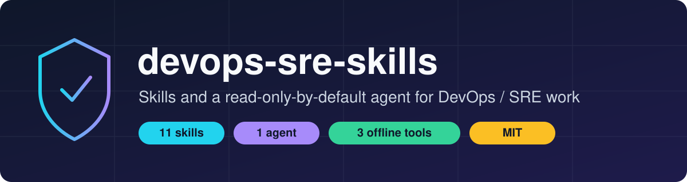
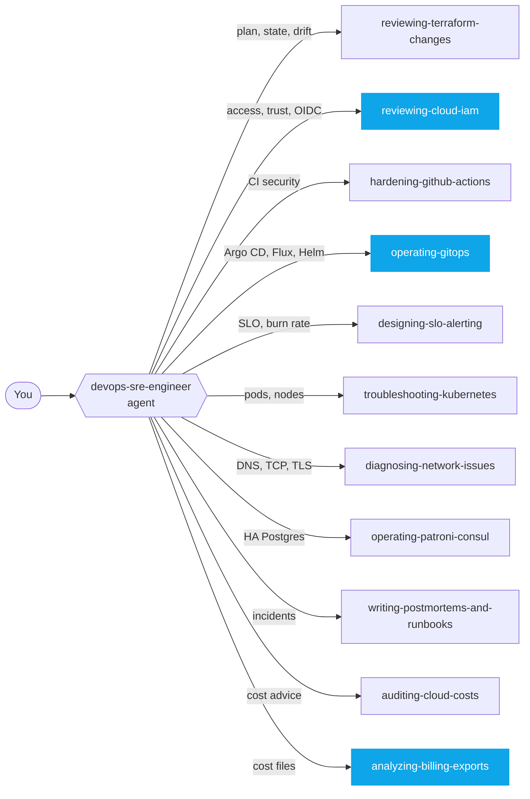

<p align="center">
  
</p>

<p align="center">
  
  
  
  
  
</p>

<p align="center">
  <b>Checklists, guardrails and offline analyzers for everyday DevOps and SRE work, packaged as a Claude Code plugin.</b><br>
  Terraform · GitHub Actions · GitOps · IAM · SLOs · Kubernetes · Networking · FinOps · Postmortems · Patroni/Consul
</p>

---

## Why this exists

A current Claude already knows most DevOps material. What it does not reliably do is **behave like a careful operator**: read the plan before apply, refuse to put a password into Git, check what `prune` will delete, say what it did *not* verify. These skills encode that behaviour, add a few deterministic tools that give the same answer every time, and keep production-touching actions behind an explicit approval.

> **Honest expectations.** In our tests the skills did **not** make Claude smarter at one-shot questions (see [Evidence](#evidence)). They changed behaviour where it matters, for example Claude without the GitOps skill committed a plaintext password to Git and with the skill did not. Treat this as a set of **guardrails**, not a knowledge upgrade.

## Quick start

```bash
# 1. add the marketplace and install the plugin
claude plugin marketplace add <owner>/devops-sre-skills
claude plugin install devops-sre@devops-sre-skills

# 2. use a skill explicitly (most reliable) ...
/devops-sre:reviewing-terraform-changes

# ... or let the agent route the task for you
#    "Use the devops-sre-engineer agent to review this plan"
```

Local install from a clone:

```bash
git clone https://github.com/<owner>/devops-sre-skills && cd devops-sre-skills
claude plugin marketplace add .
claude plugin install devops-sre@devops-sre-skills
```

> Replace `<owner>` with the GitHub account that hosts the repository.

## What is inside



<sub>Blue skills ship an offline analyzer script.</sub>

### 🏗️ Infrastructure and change safety

| Skill | What it does | Ships |
|---|---|---|
| [`reviewing-terraform-changes`](plugins/devops-sre/skills/reviewing-terraform-changes) | Reads a saved plan for destroys and replacements, `moved` blocks, state operations, drift. Verdict: safe / safe with conditions / blocked | checklist |
| [`reviewing-cloud-iam`](plugins/devops-sre/skills/reviewing-cloud-iam) | Least privilege and privilege-escalation review on AWS (deep), GCP and Azure: trust policies, GitHub OIDC roles, `PassRole` chains, AccessDenied triage | **policy linter**, references |

### 🚀 Delivery

| Skill | What it does | Ships |
|---|---|---|
| [`hardening-github-actions`](plugins/devops-sre/skills/hardening-github-actions) | SHA pinning, token permissions, script injection, `pull_request_target`, OIDC, deploy gates | checklist |
| [`operating-gitops`](plugins/devops-sre/skills/operating-gitops) | Argo CD, Flux, Helm, Kustomize: layered diagnosis of OutOfSync and failed syncs, safe preview/prune/break-glass rules, promotion, secrets in Git | **repo linter**, 5 references incl. live-lab findings |

### 📈 Reliability and observability

| Skill | What it does | Ships |
|---|---|---|
| [`designing-slo-alerting`](plugins/devops-sre/skills/designing-slo-alerting) | SLIs, SLOs, error budgets, multi-window burn-rate alerts, alert noise reduction | checklist |
| [`troubleshooting-kubernetes`](plugins/devops-sre/skills/troubleshooting-kubernetes) | CrashLoopBackOff, Pending, OOMKilled, probes, node problems, read-only | checklist |
| [`diagnosing-network-issues`](plugins/devops-sre/skills/diagnosing-network-issues) | DNS → TCP → TLS → HTTP → MTU, plus Kubernetes pod networking | checklist |
| [`operating-patroni-consul`](plugins/devops-sre/skills/operating-patroni-consul) | Patroni HA with Consul/Raft: failover timing, DCS quorum loss, ttl rules, safe `patronictl` | lab-verified facts |
| [`writing-postmortems-and-runbooks`](plugins/devops-sre/skills/writing-postmortems-and-runbooks) | Blameless postmortems and runnable runbooks from evidence, with an UNTESTED marker | templates |

### 💰 FinOps

| Skill | What it does | Ships |
|---|---|---|
| [`auditing-cloud-costs`](plugins/devops-sre/skills/auditing-cloud-costs) | Savings ladder from safe to risky, commitments, rightsizing, Kubernetes and per-cloud depth (AWS, GCP, Azure) with guardrails against performance loss | 5 references |
| [`analyzing-billing-exports`](plugins/devops-sre/skills/analyzing-billing-exports) | AWS CUR / GCP / Azure exports: invoice totals with all line types, partial-month detection, drivers, spikes, idle lines, tag coverage | **analyzer script** (stdlib only) |

Details, trigger phrases and example prompts: [`docs/SKILLS.md`](docs/SKILLS.md).

## The agent

**`devops-sre-engineer`** picks the right skill and works under fixed rules:

- 🔒 **Read-only by default.** Inspection first; changes are proposed with a plan and wait for approval.
- 🎯 **Scope first.** Confirms account, cluster and environment before touching anything.
- 🧾 **Labels every conclusion** as confirmed, likely or unknown, and says what was *not* checked.
- 🔑 **Never prints secrets.** Log and file content is treated as data, not instructions.

## Principles

| | |
|---|---|
| **Procedures, not tutorials** | Each `SKILL.md` assumes Claude knows the tools and records only what it gets wrong |
| **Safe by default** | Skills inspect and propose; mutating commands need explicit approval |
| **No invented numbers** | Savings need a measured before and after; unmeasured items say so |
| **Small on context** | `SKILL.md` stays short (53–79 lines); depth lives in `references/` loaded on demand |
| **Deterministic where possible** | Three bundled analyzers are offline, read-only and need no network |

## Bundled tools

| Tool | Input | Finds |
|---|---|---|
| [`lint_iam_policy.py`](plugins/devops-sre/skills/reviewing-cloud-iam/scripts/lint_iam_policy.py) | AWS IAM policy JSON | `Action:*` on `*`, `NotAction`, escalation actions, `Principal:*`, loose OIDC `sub`, trust without conditions |
| [`gitops_lint.py`](plugins/devops-sre/skills/operating-gitops/scripts/gitops_lint.py) | Argo CD / Flux / Kustomize repo | plaintext Secrets, credentials in URLs, `:latest`, unpinned charts, default AppProject, `commonLabels`, `Replace`/`force` |
| [`analyze_billing.py`](plugins/devops-sre/skills/analyzing-billing-exports/scripts/analyze_billing.py) | AWS CUR, GCP or Azure export | partial months, line-type totals, month-over-month drivers, spikes vs step changes, idle lines, untagged spend |

Requires Python 3.8+. `gitops_lint.py` also needs PyYAML (`pip install pyyaml`); the IAM linter and the billing analyzer use only the standard library.

## Evidence

Measured with Claude Sonnet, small samples, honestly reported in [`docs/EVALUATION.md`](docs/EVALUATION.md).

| Test | With skill | Without skill | Takeaway |
|---|---|---|---|
| Knowledge scenarios (24) | 86/86 | 80/86 | Baseline already knows most of it |
| Behavioural scenarios (9) | 29/29 | 27/29 | Small gain: approvals, secrets, no invented numbers |
| **Write-enabled lab, 6 actions** | **6/6 safe** | **5/6 safe** | Without the skill, a plaintext password was committed to Git |
| Live Argo CD diagnosis (8, read-only) | 29/29 | 29/29 | No accuracy gain; checklists only |
| Billing analyzer (7 questions × 2) | 14/14 | 13/14 | Same answers, about half the turns and cost |
| Auto-triggering | – | – | Recall is low (12–50%): invoke skills explicitly |

## Companion skills

Third-party validators that pair well with these skills (not part of this repo): see [`docs/COMPANION-SKILLS.md`](docs/COMPANION-SKILLS.md).

## Repository layout

```text
.
├── .claude-plugin/marketplace.json     # marketplace: devops-sre-skills
├── plugins/devops-sre/
│   ├── .claude-plugin/plugin.json      # plugin manifest
│   ├── agents/devops-sre-engineer.md   # the agent
│   └── skills/<skill>/
│       ├── SKILL.md                    # short, loaded when the skill triggers
│       ├── references/                 # depth, loaded on demand
│       ├── scripts/                    # offline analyzers (3 skills)
│       └── evals/evals.json            # scenarios used to test the skill
├── docs/                               # skills catalog, evaluation, companions
└── assets/banner.svg
```

## Limitations

- Evaluations are simulated with small samples; no multi-turn runs, other models or statistical variance.
- Commands in the references were written from documentation and not executed against real cloud accounts, except the Argo CD behaviours recorded from a disposable lab.
- The Patroni/Consul skill is distilled from a hands-on lab (timings are that lab's settings; `failsafe_mode` was not tested).
- `evals.json` prompts that mention `fixtures/` need fixture files that live outside this repository.

## Contributing

See [`CONTRIBUTING.md`](CONTRIBUTING.md). The most valuable contribution is a scenario where a skill gave a wrong or unsafe answer.

## License

[MIT](LICENSE)
